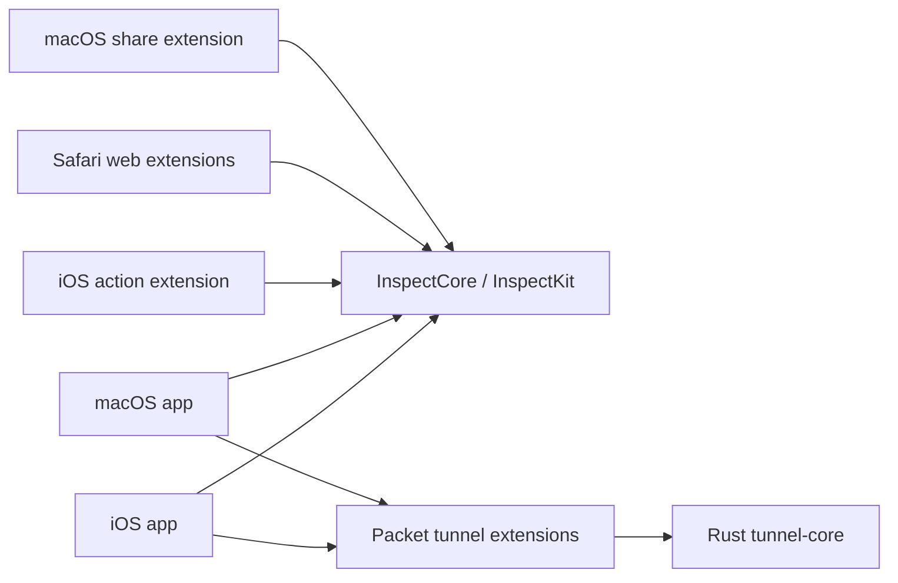

# Contributing to Inspect

## Requirements

- Xcode 27.1 or newer with the iOS 27.1 SDK
- Rust, including the Apple targets used by the packet tunnel extension
- `just`, XcodeGen, SwiftLint, SwiftFormat, and `xcbeautify`
- [App Store Connect CLI (`asc`)](https://github.com/rorkai/App-Store-Connect-CLI) for uploads, review submissions, and screenshot management

The app supports iOS 18 and macOS 15 or later. The newer SDK is needed to compile the availability-gated Duo APIs.

## Development setup

```bash
just generate
open Inspect.xcodeproj
```

`project.yml` is the source of truth. The generated `Inspect.xcodeproj` is ignored and must not be committed.

For device builds and distribution, create an ignored `project.local.yml` with your signing team and registered app group:

```yaml
name: Inspect

settings:
  base:
    DEVELOPMENT_TEAM: YOUR_TEAM_ID
    CODE_SIGN_STYLE: Automatic
    INSPECT_APP_GROUP_IDENTIFIER: group.YOUR_TEAM_ID.inspect.monitor
```

`just generate` and the release scripts include this file when it exists. It is optional for unsigned builds; keep machine-specific signing settings out of `project.yml`.

## Common commands

| Task | Command |
| --- | --- |
| Generate the Xcode project | `just generate` |
| Lint Swift | `just lint` |
| Format Swift | `just format` |
| Test the shared Swift packages | `swift test --package-path Packages/InspectCore` |
| Test on an iOS simulator | `just test-ios-sim <SIMULATOR_UDID>` |
| Build or test macOS | `just build-macos`, `just test-macos` |
| Run macOS | `just run-mac` |
| Run on a connected iPhone | `just run-ios-device` |
| Test Rust | `just rust test` |
| Run the tunnel forwarding harness | `just rust tun2proxy-harness` |
| Update Certificate Transparency logs | `just update-ct-logs` |

Prefer `xcodebuild ... | xcbeautify` for build output. Set `DEVICE_ID` when more than one iPhone is connected. Shared logs are available in Settings diagnostics; the device recipe also copies the tunnel log locally.

## Architecture

| Path | Responsibility |
| --- | --- |
| `Apps/iOS/` | iOS app shell and settings |
| `Apps/macOS/` | macOS app shell and settings |
| `Extensions/Action/` | iOS action/share extension |
| `Extensions/ActionShared/` | Shared action-extension behavior |
| `Extensions/SafariWeb/` | Safari web extensions for iOS and macOS |
| `Extensions/MacShare/` | macOS share extension |
| `Packages/InspectCore/` | Shared Swift models, feature UI, logging, stores, and tests |
| `Extensions/PacketTunnel/` | iOS/macOS packet tunnel wrappers and Rust bridge |
| `Rust/tunnel-core/` | Rust forwarding core |



The packet tunnel extensions link the Rust static library directly; `InspectCore` does not link Rust.

### Inspection and handoff

- **Manual inspection:** the app or extension resolves a host or URL, `TLSInspector` opens a TLS connection, and the normalized `TLSInspectionReport` drives the shared UI.
- **Safari:** the popup asks its native handler to inspect the current URL. Open Full Details saves the report in the app group and opens `inspect://certificate-detail?...`.
- **macOS Share:** the extension extracts the URL, runs an inspection, saves the report, and queues a handoff token. The app activates and consumes that report in its existing window.

### Live Monitor

`LiveMonitorManager` starts the packet tunnel. The extension configures the network and launches `tunnel-core`, which uses `tun2proxy` to forward traffic and observe TLS. Observations are written to the app group feed and log; `InspectionMonitorStore` aggregates hosts and reports for the UI.

TCP/TLS observations and passive SNI/certificate capture are supported by the current path. UDP forwarding exists in `tun2proxy`, but Inspect does not surface UDP observations. QUIC/HTTP3 certificate capture is not implemented.

## Release workflow

### Upload builds

Create the local credential configuration:

```bash
cp .env.example .env
```

Set these values in `.env`:

- `ASC_APP_ID`
- `APP_STORE_CONNECT_KEY_ID`
- `APP_STORE_CONNECT_ISSUER_ID`
- `APP_STORE_CONNECT_KEY_PATH`

Configure signing in `project.local.yml` as described above. Both platforms share `MARKETING_VERSION` and `CURRENT_PROJECT_VERSION` in `project.yml`.

Upload through `scripts/testflight.sh`, using these recipes sequentially because they share the archive and export paths:

```bash
just testflight
TESTFLIGHT_SCHEME=InspectMac TESTFLIGHT_DESTINATION="generic/platform=macOS" just testflight
```

The script regenerates the project, selects a build number using App Store Connect and the project setting, archives with automatic signing, exports an IPA or PKG, uploads it, and waits for processing. Set `TESTFLIGHT_BUILD_NUMBER` in `.env` to an unused number if the selected platform already has the number the script chooses.

`TESTFLIGHT_GROUP` optionally distributes the build to a beta group. Leave it empty for upload only. `TESTFLIGHT_NOTIFY` controls tester notifications.

Useful variants:

- `just testflight-build` archives and exports without uploading.
- `just testflight-dry-run` archives and exports, then previews the upload.
- Prefix either recipe with the macOS scheme and destination shown above to use macOS.

Outputs are under `build/testflight/`. Verify the archive version, signed export, and App Store Connect processing state. If iOS export fails because `embedded.mobileprovision` is missing after an Xcode upgrade, download manual profiles in Xcode > Settings > Accounts and retry.

### Submit for App Review

An uploaded build is separate from an App Store version and review submission. For each platform:

1. Create or select the App Store version, preserving existing listing metadata and release policy.
2. Update What's New, attach the exact processed build, and check review details and screenshot delivery.
3. Run `asc validate` for that platform and version; resolve blocking findings before submitting.
4. Submit the prepared version with `asc review submit --confirm`, selecting the exact build.
5. Verify the review submission state with `asc review status`.

For example, after preparing metadata and screenshots:

```bash
asc validate --app "$ASC_APP_ID" --version "$VERSION" --platform IOS
asc review submit --app "$ASC_APP_ID" --version "$VERSION" --platform IOS --build-number "$BUILD_NUMBER" --confirm
asc review status --app "$ASC_APP_ID" --platform IOS
```

Use `MAC_OS` for the macOS version. These direct `asc` commands require an authenticated CLI profile or the normalized `ASC_*` authentication environment; the repository scripts load `.env` automatically.

## App Store screenshots

Use the built-in `INSPECT_SCREENSHOT_SCENARIO` launch mode through `scripts/app_store_screenshots.sh` rather than editing UI state by hand:

```bash
just app-store-screenshots
```

Captures are written under `build/app-store-screenshots/output/`. Inspect the rendered images as well as their dimensions: a successful size check does not establish that the screen contains the intended content.

### Choose device sets

`SCREENSHOTS_SETS` selects the sets to capture or upload:

| Value | Sets |
| --- | --- |
| `duo` (default) | iPhone Duo |
| `all` | iPhone 6.5-inch, iPad 12.9-inch, and Duo |
| `iphone`, `ipad`, `duo,ipad`, etc. | The selected combination |

```bash
SCREENSHOTS_SETS=all just app-store-screenshots
```

| Output directory | App Store display type |
| --- | --- |
| `iphone/` | `APP_IPHONE_65` |
| `ipad/` | `APP_IPAD_PRO_3GEN_129` |
| `duo-outer/` and `duo-inner/` | `APP_IPHONE_DUO` |

The script provisions simulators only for selected sets and selects a compatible runtime for each device type.

### Capture Duo displays

The simulator presents one display at a time. Open Xcode > Open Developer Tool > Device Hub, select **Inspect App Store iPhone Duo**, and set the pose before capturing:

| `SCREENSHOTS_DUO_DISPLAY` | Pose | Command |
| --- | --- | --- |
| `outer` (default) | Folded | `just app-store-screenshots` |
| `inner` | Unfolded | `just app-store-screenshots-duo-inner` |
| `both` | Outer, then pause to unfold | `just app-store-screenshots-duo-both` |

`both` needs an interactive terminal to wait for Return between poses. Without one, run the two passes separately. The script rejects uniform blank frames from the inactive display and clears only the display being captured. Environment overrides take precedence over screenshot defaults in `.env`.

Accepted Duo dimensions are outer `1398×2034` and inner `2007×2853`, or their landscape equivalents.

Certificate detail uses `ArrangementView` on iOS 27.1 and later and a single list on earlier systems. Recapture affected device sets when layout or SDK availability changes.

### Upload screenshots

```bash
./scripts/app_store_screenshots.sh upload <VERSION_LOCALIZATION_ID>
./scripts/app_store_screenshots.sh capture-upload <VERSION_LOCALIZATION_ID>
```

Uploads replace the existing display-type set with `--replace --confirm`; set `SCREENSHOTS_UPLOAD_APPEND=YES` to append instead. Both Duo folders are merged into one `APP_IPHONE_DUO` set with inner-display captures first. Verify each uploaded asset reaches `COMPLETE` before submission.
