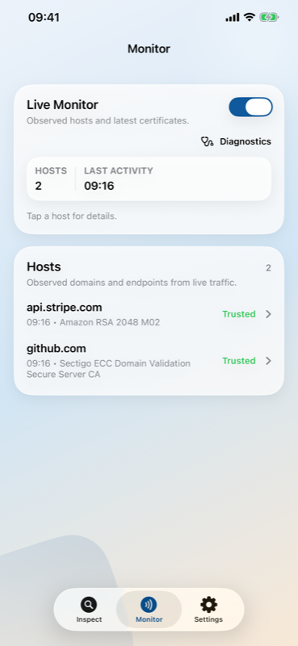
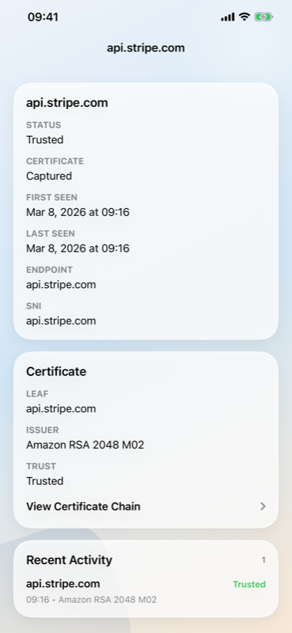
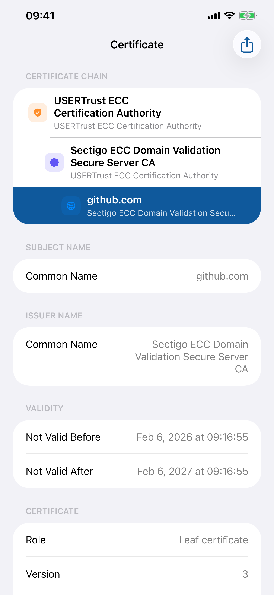
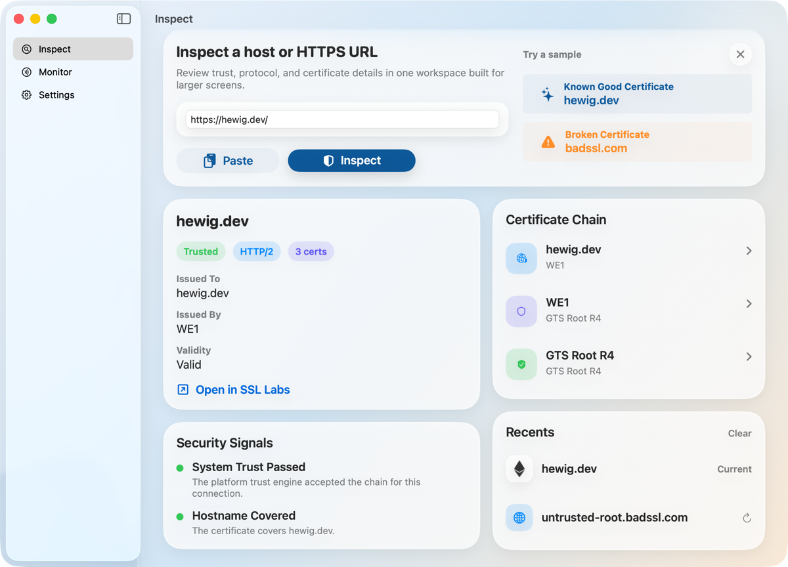

# Inspect

A TLS certificate inspector for iPhone, iPad, and Mac. Inspect a website, review its trust chain and security signals, and export certificates for debugging.

**[Download on the App Store](https://apps.apple.com/us/app/inspect-view-tls-certificate/id1074957486)** · [Website](https://inspect.hewig.dev)

## Features

- **Inspect any HTTPS endpoint.** Enter a host or URL, follow redirects, and review the certificate chain served at each hop.
- **Understand trust and revocation.** Check system trust, hostname coverage, validity, OCSP/CRL status, weak cryptography, and signs of interception.
- **Browse certificate details.** Explore X.509 fields, SANs, key usage, public keys, fingerprints, Certificate Transparency logs, and extensions.
- **Use Safari and Share.** Inspect the current page from Safari or send a URL to Inspect from another app.
- **Watch observed hosts.** Live Monitor uses a local packet tunnel to collect TLS observations and track certificate changes while you browse.
- **Export and compare.** Share DER certificates or copy individual certificates and full chains as PEM.

## Screenshots

| Live Monitor | Host details | Certificate chain |
| --- | --- | --- |
|  |  |  |

## Contributing

Start with [CONTRIBUTING.md](CONTRIBUTING.md). See [DEVELOPMENT.md](DEVELOPMENT.md) for architecture, local commands, screenshots, and release workflows.

## License

BSL 1.1 — free to use, modify, and redistribute; paid app store distribution requires permission. Converts to Apache-2.0 on 2030-03-23. See [LICENSE](LICENSE).
